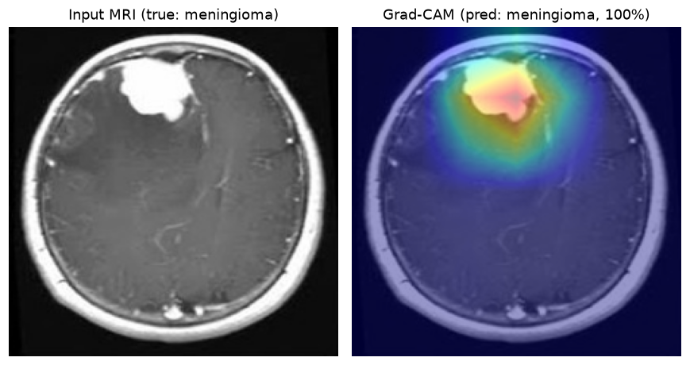
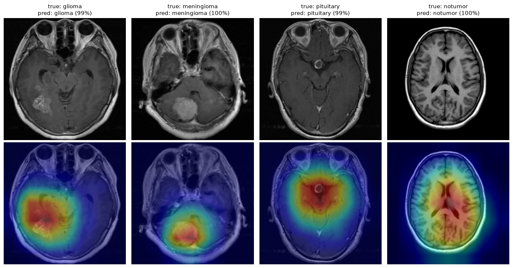

# NeuroScan

Brain MRI tumor classification (**glioma, meningioma, pituitary, no tumor**) with transfer learning and
Grad-CAM explanations, built with a focus on **honest evaluation**: leakage-free data splits,
macro-F1 with confidence intervals, error analysis and shortcut-learning checks.

> ⚠️ Educational project. **Not a medical device**: do not use it for diagnosis.



## Results

| Split | Images | Macro-F1 | Accuracy |
|---|---|---|---|
| Validation (model selection) | 903 | 0.983 | 0.982 |
| **Test** (used once, at the end) | 903 | **0.978** (95% CI 0.968–0.987) | 0.978 |

Model: ResNet18 pretrained on ImageNet (`timm`, `resnet18.a1_in1k`), fine-tuned end-to-end.
The confidence interval is a 1000-sample bootstrap over the test set.

| Class | Precision | Recall | F1 |
|---|---|---|---|
| glioma | 0.992 | 0.955 | 0.973 |
| meningioma | 0.944 | 0.991 | 0.967 |
| notumor | 0.980 | 0.980 | 0.980 |
| pituitary | 0.992 | 0.989 | 0.990 |



## Key findings

**1. The official dataset split leaks.** The dataset (version 2) states that duplicates and train/test overlap
were removed, and indeed no test file is byte-identical to a training file. But with perceptual hashing
(`imagehash.phash`), which also catches re-encoded or resized copies, the 7,200 images contain 988 redundant
copies and **23.1% of the official test images have a near-duplicate in the training set**.
There is also 1 label conflict and 203 pre-augmented images. After cleaning, 6,020 unique images were
re-split into a stratified 70/15/15 train/val/test split with no hash overlap. Results reported on the
official split of this dataset are therefore likely inflated.

**2. Source bias.** The *notumor* class looks like a different source: smaller images, brighter, more
T2/FLAIR sequences. Part of the brightness gap came from black borders (fixed by cropping);
the rest is style. Mitigation: border cropping, per-image normalization, gamma augmentation.

**3. Errors concentrate in one folder.** 11 of the 20 test errors are glioma → meningioma. Glioma images
from the original Kaggle `Testing/` folder have accuracy **0.825**, against **0.995** for gliomas from `Training/`
(every other class/origin ≥ 0.98). The dataset author notes that the SARTAJ glioma images had label
inconsistencies and were replaced with figshare images; all training gliomas are 512×512 like figshare,
but 76 of the 400 original test gliomas have other sizes, and on those that ended up in our test set the
accuracy is **0.417** (7/12 wrong). Grad-CAM shows the model *does* look at the lesion in these cases:
likely label noise or ambiguous cases, not a model blind spot. They were **not** fixed, because changing
data or model after looking at the test set would bias the estimate.

**4. Possible shortcut on notumor.** Grad-CAM maps are lesion-focused for meningioma and pituitary,
but diffuse for *notumor*, and two tumors predicted as *notumor* with ≥ 0.99 confidence (one T2 image)
get the same diffuse maps. Hypothesis: the model partly associates the T2/FLAIR look with *notumor*.

**5. Overconfidence.** About half of the errors have softmax confidence > 0.9, so the probabilities
should be read as scores, not as certainty.

## Method

1. **EDA & cleaning** (`notebooks/01_eda.ipynb`): class balance, sizes and modes, intensity bias,
   perceptual-hash deduplication, new stratified split saved in `splits/`.
2. **Preprocessing & training** (`notebooks/02_preprocessing_training.ipynb`):
   RGB → black-border crop → resize 224×224 → augmentation (flip, small affine, random gamma; train only)
   → per-image normalization. Class-weighted cross-entropy, AdamW (lr 3e-4), cosine schedule,
   best epoch selected on validation macro-F1.
3. **Evaluation & Grad-CAM** (`notebooks/03_evaluation_gradcam.ipynb`): test metrics, confusion matrix,
   error gallery, bootstrap CI, Grad-CAM on `layer4`.
4. **Web app** (`app/app.py`): Streamlit demo with prediction, class probabilities and Grad-CAM overlay.

## Project structure

```
NeuroScan/
├── app/app.py                  # Streamlit demo
├── assets/                     # README figures
├── notebooks/
│   ├── 01_eda.ipynb
│   ├── 02_preprocessing_training.ipynb
│   └── 03_evaluation_gradcam.ipynb
├── splits/                     # clean train/val/test CSVs (path, label)
├── src/
│   ├── data.py                 # crop, transforms, Dataset
│   ├── model.py                # model, checkpoints, train/evaluate
│   ├── gradcam.py              # Grad-CAM
│   └── download_data.py        # dataset download (Kaggle)
├── data/                       # raw images (not versioned)
└── models/                     # trained checkpoint (not versioned)
```

## Getting started

```bash
python -m venv venv
venv\Scripts\activate            # Windows  (Linux/macOS: source venv/bin/activate)
pip install -r requirements.txt
```

`pip install torch` installs a CPU-only build on Windows. For an NVIDIA GPU, install the CUDA build
(see [pytorch.org](https://pytorch.org/get-started/locally/)), e.g.:

```bash
pip install --force-reinstall torch torchvision --index-url https://download.pytorch.org/whl/cu126
```

Then:

```bash
python src/download_data.py      # dataset -> data/raw/
```

1. Run `notebooks/02_preprocessing_training.ipynb` to train the model (~15 min on a GTX 1050 Ti); it saves
   `models/resnet18_best.pt`. The splits in `splits/` are already versioned, so notebook 01 is optional.
2. Run `notebooks/03_evaluation_gradcam.ipynb` for the evaluation.
3. Start the app:

```bash
streamlit run app/app.py
```

## Limitations

- One public dataset, single 2D slices, **no patient IDs**: different slices of the same patient may
  end up in different splits, so patient-level leakage cannot be ruled out.
- Some labels are doubtful (see finding 3), and part of the dataset comes from different sources and
  MRI sequences (see finding 2).
- No external validation on data from another hospital or scanner.
- Grad-CAM is coarse (7×7 grid) and qualitative: it suggests hypotheses, it does not prove them.

## Dataset

[Brain Tumor MRI Dataset](https://www.kaggle.com/datasets/masoudnickparvar/brain-tumor-mri-dataset)
(version 2) by Masoud Nickparvar, a combination of the figshare, SARTAJ and Br35H datasets,
licensed under [CC BY 4.0](https://creativecommons.org/licenses/by/4.0/).
The example images in `assets/` are derived from this dataset (cropped, resized, Grad-CAM overlay added).
